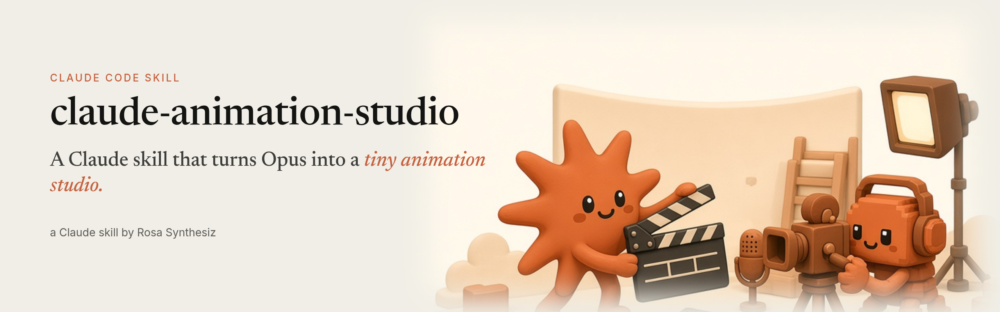
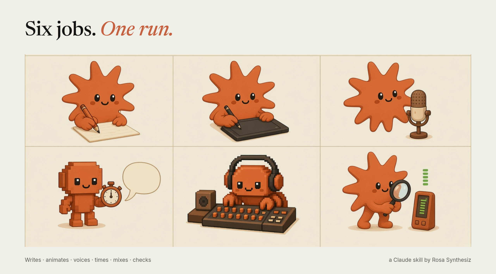
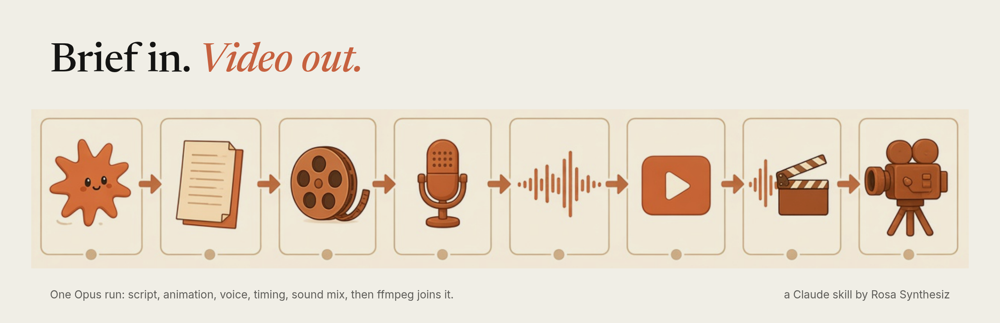
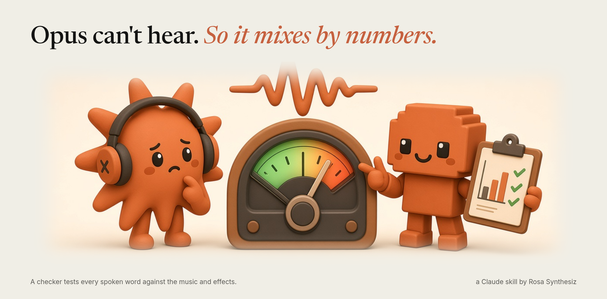

<div align="center">



# claude-animation-studio

**Turn Claude Opus into a tiny animation studio.**

[](https://docs.claude.com/en/docs/claude-code/skills)
[](LICENSE)
[](https://www.python.org)
[](#requirements)

[What it does](#what-it-does) · [How it works](#how-it-works) · [Install](#install) · [Quick start](#quick-start) · [Mix by numbers](#mix-by-numbers)

</div>

---

## What it does

You give Claude a topic. It hands you back a ~35-second, 9:16 cartoon explainer: scripted, animated,
voiced, sound-designed and mixed, all on your own machine.

No video model is involved. Claude writes the animation as code (HTML + GSAP), a headless browser
captures every frame, and ffmpeg encodes it. Voice and word timing run locally, and the sound mix is
written as numbers and checked by a script.

The demo is a 37-second cartoon about the Great Emu War of 1932, made in one run.

<p align="center"></p>

| | Role | What it does |
|:-:|---|---|
| ✍️ | **Writer** | Turns verified facts into a beat sheet and 7 deadpan lines that fit the length |
| 🎨 | **Animator** | Builds the frames in HTML/GSAP with [HyperFrames](https://github.com/heygen-com/hyperframes); headless Chrome + ffmpeg render them |
| 🎙️ | **Voice actor** | Reads the script with local [Kokoro](https://github.com/hexgrad/kokoro) TTS and splices in comedy pauses |
| 🔊 | **Sound designer** | Gets word timings from [Parakeet](https://huggingface.co/nvidia/parakeet-tdt-0.6b-v2) and pins cartoon SFX and music to spoken words |
| 🎚️ | **Mixer / QC** | Mixes to dB targets; `level_check.py` checks every word against the music and SFX |

## How it works

<p align="center"></p>

Claude writes a `BRIEF.md` (facts, beats, palette, mix targets) and sends it to **one Opus subagent**,
which plays all five roles in a single run. You get the MP4 and a short `LISTEN.md` of moments to check
by ear. Then you give notes ("music +2 dB"), and each pass makes one measured change.

## Requirements

| Tool | Used for | Install |
|---|---|---|
| [Claude Code](https://docs.claude.com/en/docs/claude-code/overview) | runs the skill and the Opus subagent | see docs |
| [Node.js](https://nodejs.org) 22+ | HyperFrames CLI | nodejs.org |
| [HyperFrames](https://github.com/heygen-com/hyperframes) | HTML → video via headless Chrome | `npx skills add heygen-com/hyperframes` |
| [FFmpeg](https://ffmpeg.org/download.html) | encoding, filters, loudness | package manager |
| Python 3.10+ | `tools/*.py` | `pip install numpy soundfile` |
| [Kokoro](https://github.com/hexgrad/kokoro) | local text-to-speech | `pip install kokoro` + `espeak-ng` |
| [Parakeet TDT 0.6B v2](https://huggingface.co/nvidia/parakeet-tdt-0.6b-v2) | local word timestamps | `pip install -U "nemo_toolkit[asr]"` |

> [!NOTE]
> **Bring your own sounds.** No audio ships with this repo. `tools/cues.json` and `tools/beds.json` are templates
> with placeholder paths (e.g. `sfx/womp.wav`) relative to `$OVS_SOUNDS_DIR`. Use files you own or that are
> royalty-free. [`references/mix-and-sound.md`](references/mix-and-sound.md) describes what each sound should be.

## Install

```bash
git clone https://github.com/rosasynthesiz/claude-animation-studio.git
mkdir -p ~/.claude/skills
cp -r claude-animation-studio ~/.claude/skills/opus-video-short
```

Optional settings:

```bash
export OVS_SOUNDS_DIR=~/sounds      # your SFX and music (default ./sounds)
export OVS_PROJECTS_DIR=~/videos    # where episode projects go (default ./videos)
```

## Quick start

1. In Claude Code, ask: **"make a short about the Great Emu War"**
2. Claude researches the facts, writes `BRIEF.md`, and starts the build.
3. Before the audio build, check your sounds: `python3 tools/build_audio.py --dry-run`
4. Get `renders/video.mp4` (1080×1920) plus `LISTEN.md`.
5. Give notes; each pass re-runs `tools/level_check.py` until it prints `RESULT: PASS`.

## Mix by numbers

Claude can't hear, so the mix is written as targets and then measured.

<p align="center"></p>

| Layer | While the voice speaks | In the gaps |
|---|---|---|
| Voice | −16 dBFS RMS per line · 3:1 comp · HPF 90 Hz · +2 dB @ 3 kHz | — |
| Music | ~10 dB under the voice (sidechain duck, −3.5 dB @ 2.5 kHz), between −25 and −31 dBFS | −20 to −24 dBFS |
| SFX | ≥ 7 dB under the word they overlap | free |
| White hold | silent | — |
| Master | −14 LUFS · −1 to −2 dBTP | — |

`level_check.py` passes only if every spoken word sits at least 6 dB over music + SFX (5 dB for quiet
words), the music stays audible, and the silent moment really is silent.

## File layout

```
.
├── SKILL.md                     # the process Claude follows
├── references/
│   ├── brief-template.md        # BRIEF.md structure
│   ├── subagent-prompt.md       # prompt for the build subagent
│   └── mix-and-sound.md         # mix targets and sound roles
├── tools/
│   ├── build_audio.py           # voice, music and SFX build (--dry-run)
│   ├── splice_vo.py             # comedy-pause splicer
│   ├── level_check.py           # per-word level check
│   ├── cues.json                # SFX cue template
│   └── beds.json                # music bed template
└── assets/                      # README images
```

## Credits

Built by **Rosa Synthesiz**.

It stands on [HyperFrames](https://github.com/heygen-com/hyperframes), [Kokoro-82M](https://huggingface.co/hexgrad/Kokoro-82M),
[NVIDIA Parakeet](https://huggingface.co/nvidia/parakeet-tdt-0.6b-v2) (CC-BY-4.0), [GSAP](https://gsap.com) and [FFmpeg](https://ffmpeg.org).

## License

MIT. See [LICENSE](LICENSE).
